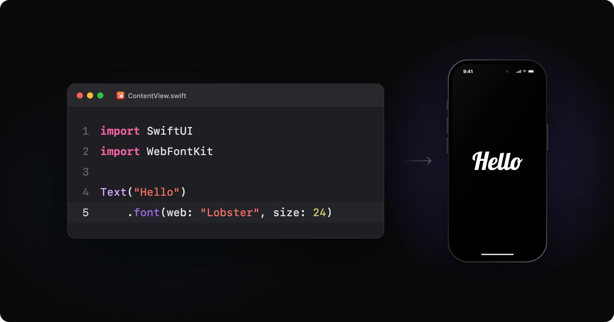

# WebFontKit

[](https://github.com/ItzNotABug/WebFontKit/actions/workflows/ci.yml)
[](https://www.swift.org)
[](#installation)
[](LICENSE)

Any Google Font by name, in one line of SwiftUI. Downloaded once, kept on disk, and registered with the system like any
bundled font.

<p align="center">
  
</p>

- Shows the system font until the font is ready, then swaps it in.
- Scales with Dynamic Type, and works offline after the first load.
- Once loaded, `Font.custom` and `UIFont(name:size:)` draw it too.
- One request per font, however many views ask for it.
- No dependencies. Swift 6 strict concurrency.

## Installation

```swift
.package(url: "https://github.com/ItzNotABug/WebFontKit.git", from: "1.0.0")
```

In Xcode: **File › Add Package Dependencies…**, paste the URL, and add the `WebFontKit` product.

Requires iOS 17+ or macOS 14+, and Xcode 26+.

## Usage

```swift
Text("Hello").font(web: "Lobster", size: 24)
Text("Hello").font(web: "Inter", size: 17, weight: .bold, italic: true)
Text("12:45").font(web: "Bebas Neue", fixedSize: 64)  // ignores Dynamic Type
```

<details>
<summary><b>Loading state</b></summary>

```swift
Text("Hello").font(web: "Pacifico", size: 28) { phase in
    switch phase {
    case .loading:
        showSpinner = true
    case .loaded:
        showSpinner = false
    case .failed(let error):
        print(error)  // .notFound, .offline, …
    }
}
```

</details>

<details>
<summary><b>UIKit, widgets and App Intents</b></summary>

Load first, then use Apple's APIs:

```swift
try await WebFonts.shared.load("Inter", styles: [.regular, .bold])
label.font = UIFont(name: "Inter", size: 17)
```

A widget renders once, so load in its timeline provider before returning the entry. To share fonts with the app,
configure both with the App Group container:

```swift
WebFonts.shared.configure(.init(directory: appGroupURL))
```

</details>

<details>
<summary><b>Prefetching</b></summary>

```swift
let results = await WebFonts.shared.load(["Lobster", "Caveat", "Inter"])  // never throws
for (family, error) in results.failed {
    print(family, error)
}
```

</details>

<details>
<summary><b>Your own server or source</b></summary>

Configure once at launch. Every source works with the same `.font(web:)` and `load` calls.

```swift
// Files on your server: Inter.ttf, Inter-Bold.ttf, Inter-Italic.ttf, Inter-300.ttf, …
WebFonts.shared.configure(.init(source: .hosted(at: URL(string: "https://cdn.example.com/fonts")!)))
```

Your own URLs or auth: return a request, and WebFontKit downloads it.

```swift
struct MyServer: RemoteFontSource {
    let token: String

    func request(for font: FontRequest) async throws -> URLRequest {
        var request = URLRequest(url: URL(string: "https://fonts.example.com/\(font.family)-\(font.style.weight).ttf")!)
        request.setValue("Bearer \(token)", forHTTPHeaderField: "Authorization")
        return request
    }
}

WebFonts.shared.configure(.init(source: MyServer(token: token)))
```

Bytes from anywhere: TrueType, OpenType, WOFF or WOFF2.

```swift
struct MyClient: FontSource {
    func fetch(_ font: FontRequest) async throws -> Data {
        guard let data = try await api.font(font.family, weight: font.style.weight) else {
            throw WebFontError.notFound  // a face you don't have
        }
        return data
    }

    // Optional: bump it to replace stored files.
    func cacheKey(for font: FontRequest) -> String {
        "\(font.family)-v2"
    }
}
```

</details>

<details>
<summary><b>Storage, stored fonts and events</b></summary>

```swift
WebFonts.shared.configure(.init(storage: .session))  // keep fonts for this launch only

let stored = WebFonts.shared.downloaded  // family, style, PostScript name, size, date
try await WebFonts.shared.remove("Lobster")
try await WebFonts.shared.removeAll()

for await event in WebFonts.shared.events {  // loads, failures, removals
    print(event)
}
```

</details>

## Good to know

- **Fast first loads.** A bundled catalogue of Google's font URLs (~133 KB) means a new font is a single download.
  Anything it doesn't cover asks Google instead, and a weekly job keeps it current.

- **Load every style you draw.** iOS never fakes bold or italic for a downloaded font. A style the family doesn't have
  draws in its regular face.

- **Privacy.** Like any web font, the default source sends the user's IP address to Google. Mention it in your privacy
  policy, or self-host.

- **Logging.** Logs go to the unified log under the `com.itznotabug.webfontkit` subsystem, with file paths kept private.

- **Licenses.** Google Fonts are open source, mostly under the SIL Open Font License. See
  Google's [attributions](https://fonts.google.com/attribution).

For the full guide (styles, system fonts, widgets, self-hosting), open the package in Xcode and choose **Product › Build
Documentation**.

## Example app

Try any family, browse a type gallery, manage stored fonts and watch live events.

Open `Example/WebFontKitExample.xcodeproj` and run **Showcase**.    
For a device, add your signing to `Example/Signing.local.xcconfig`:

```
DEVELOPMENT_TEAM = <your team ID>
BUNDLE_ID_PREFIX = <a prefix you own>
```

## Development

`scripts/build.sh` builds everything with zero warnings, and `scripts/verify.sh` runs every test suite on macOS and iOS
before a release. Both need [XcodeGen](https://github.com/yonaskolb/XcodeGen) for the Example app.

## License

Apache 2.0; see [LICENSE](LICENSE). Fonts keep their own licenses.
